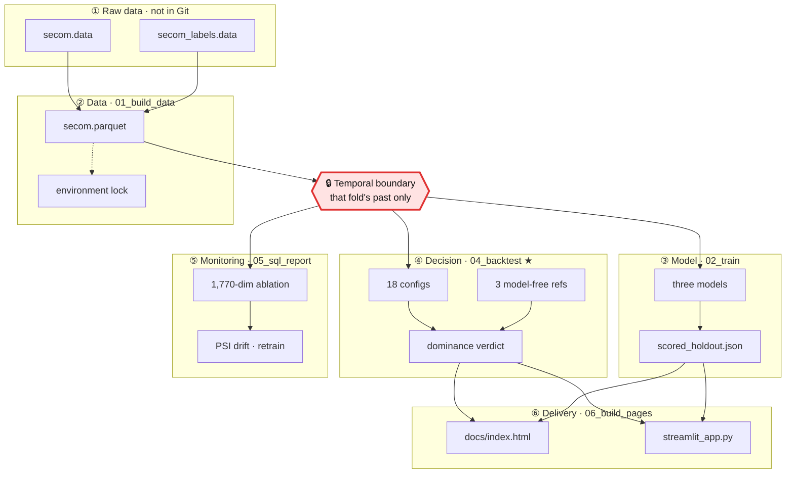

# Beyond AUC: Cost-Sensitive Deployment Evaluation for Semiconductor Quality Inspection

> Under class imbalance, limited inspection capacity, and distribution drift, can a model beat full inspection or random sampling on total cost?

[](https://github.com/mina201199/secom-cost-sensitive-eval/actions/workflows/ci.yml)

**▶ [Interactive cost explorer](docs/index.html)** (`docs/index.html`) — no install; GitHub shows HTML files as source, so download the file and open it in a browser, then change the cost and capacity assumptions and watch the policy respond

[](docs/demo.mp4)

*30-second demo (Traditional Chinese captions): change the cost assumptions, add a capacity cap, then see the rolling backtest where none of the 18 configurations clears the bar.*

[繁體中文](README.zh-TW.md) · [Generated experiment report](reports/executive_summary.md)

## TL;DR

- **Business takeaway: under the current cost assumptions, do not deploy the model.** None of 18 model × policy × capacity configurations is cheaper than a model-free policy (0 / 18): inspect everything when capacity is unconstrained, sample at random up to the quota when capped at 20%.
- **Why it is credible:** the bar is derived in advance (lift must exceed 1; measured median 0.86), permutation test p = 0.52, and the bootstrap interval for the cost difference straddles zero.
- **What it would take to re-evaluate:** with 33 positives the minimum detectable ROC-AUC is 0.644; detecting AUC 0.60 needs roughly 69 failures (2.1×), plus confirmed real costs and inspection effectiveness.
- Source of every number: [`reports/executive_summary.md`](reports/executive_summary.md), generated by the scripts from `reports/metrics/*.json`.

## The problem

Many items to screen, fewer than 5% of them actually bad (4.7% pooled across the four evaluation windows), a hard cap on how many can be checked, missing one costing **30×** what checking one costs, and a distribution that drifts over time. Who should be checked first?

That shape is not specific to semiconductors — it is inspection scheduling in manufacturing, AML alert triage and fraud review queues in banking, and screening triage in medicine. This project uses the public [UCI SECOM](https://archive.ics.uci.edu/dataset/179/secom) yield dataset as its vehicle.

**Most projects ask whether a model is accurate; this one asks whether a model is worth using**: spend a limited inspection budget according to the model's scores, and does the total cost come in below using no model at all? So the comparison set is "always inspect everything" and "sample at random", not another model.

## Results

Eighteen configurations compared on identical future windows with walk-forward backtesting, against three fixed model-free policies (sources: `reports/metrics/backtest.json`, `reports/executive_summary.md`):

| Capacity regime | Cheapest model-free policy | Cost/unit | Cheapest model-driven config | Cost/unit | Configs beating model-free |
| --- | --- | ---: | --- | ---: | :---: |
| Unconstrained | Always inspect everything | **2,000** | majority/robust\* | 2,000 | **0 / 9** |
| At most 20% inspected | Random at the same quota | **2,644** | lgbm/threshold | 2,677 | **0 / 9** |

\* `majority` is a zero-information DummyClassifier whose conservative policy degenerates to inspecting 100%, so that 2,000 *is* full inspection wearing a model's name — a tie, not a win (the verdict uses a strict inequality). Every configuration that actually ranks is dearer; the cheapest is `lgbm/robust` at 2,042.

- **The bar can be computed in advance.** With R = escape ÷ inspection cost and p = prevalence, whenever p·R ≥ 1 (here 1.40) the condition for a model to add value reduces to **lift > 1**. Measured median across four windows: **0.86**.
- **Permutation test p = 0.52.** The flagged set is indistinguishable in cost from a random set at the same quota.
- **The 95% bootstrap interval for the cost difference straddles zero** (relative saving −23.5% to +15.9%); the model is cheaper in only 43.6% of resamples.
- **This design cannot see a small signal.** With 33 positives the minimum detectable ROC-AUC is **0.644** and the measured value sits near 0.5 — the sample size cannot answer the question, which is not the same as proving the model useless.


The mechanism is drift. Against the first fold's training window, PSI is computable for 452 of the 590 sensors (the other 138 are entirely missing — 16 — or constant — 122 — so PSI is undefined rather than zero). Among those 452, the share past PSI > 0.25 rises monotonically across the four windows: **61% → 64% → 70% → 75%**.


The earlier +12.4% and 8.7:1 claims (threshold chosen on the test set) are superseded; the report is the single source.

## Data and assumptions

UCI SECOM has 1,567 observations, 104 failures and 590 anonymous sensor columns; 4.5% of cells are missing and 116 columns are constant. Labels are in-house pass/fail tests, not customer escapes. Scenario assumptions: one observation equals one independently inspectable unit, inspection always intercepts a selected failure, TWD 2,000 per inspection, TWD 60,000 per escape. Sensor availability at decision time still needs confirmation.

**The cost assumption itself sets the difficulty.** 2,000 : 60,000 gives p·R = 1.40 > 1, the region where a model only has to beat random sampling — the most permissive region available to it. It still did not.

## Design decisions: keeping the evaluation honest

- Chronological outer windows; preprocessing, inner-CV binning and training use only that fold's past.
- Final tree count comes from inner CV; OOF calibration uses a count fixed in advance so later labels cannot tune it.
- The calibration window is used for calibration and policy selection, never scored as an independent result.
- Each cost ratio selects its threshold on validation and is priced on future windows; no test-optimized break-even claim.
- All models, policies and capacities share identical windows; the headline compares against **fixed model-free policies**, which cannot pick wrong.
- Zero-failure windows are kept for cost; undefined metrics are null.
- The SQL ablation builds history features for all sensors, without selecting them by test-set SHAP.

Disclosed up front (details in the report): the "conservative" policy is really a switch to near-full inspection (the four folds select 86% / 28% / 98% / 95%), so its gain comes from inspection rate, not ranking; Platt scaling is monotone and leaves quantile decisions unchanged (`test_calibration_does_not_change_rank_based_decisions`); the `min_estimators: 10` floor binds in one fold; AUC is deliberately not a retraining trigger because at 33 positives its noise exceeds any real change.

| Component | Comparison |
| --- | --- |
| Models | Dummy prior, L2 logistic regression, LightGBM |
| Policies | Absolute threshold, quantile, conservative base-rate adjustment |
| Model-free references | Inspect nothing, inspect everything, random at an integer quota |
| Uncertainty | Minimum detectable effect, bootstrap interval for cost difference, exact permutation test |
| Monitoring | Prevalence-regime call, feature PSI, retraining trigger |
| Ablation | 590 raw sensors vs 1,180 additional historical deviations (DuckDB) |

## Applying this to AI / LLM product evaluation

This repo contains no LLM experiments; these are the parts of the method that transfer directly:

- **Beat a no-model baseline first, not another model.** Before shipping an LLM feature, compare total cost against "route everything to humans", rules/keywords, or random spot checks — not just accuracy.
- **Weight errors by cost.** A wrong answer (complaint, bad action) and a human review usually differ in cost by a large factor; R = 30 here plays that role and tells you in advance how good the model must be to pay off.
- **Capacity = the human review queue.** Choosing which outputs to send for review by confidence score is the same problem as "inspect at most 20%": the selected items must have a higher error rate than a random pick at the same quota (lift > 1).
- **Pick thresholds on validation, price them on future data.** Refusal or confidence thresholds must not be tuned on the test set; user queries drift, so split by time and monitor input distribution (PSI here).
- **Size the eval set before trusting it.** Differences between two prompts or models on a small golden set often sit inside the bootstrap interval or permutation noise; a power analysis says how many labels you need.

## Architecture

Six layers between two raw UCI files and a one-page static explorer anyone can open. The red cell is the leakage boundary.



With 1,567 rows and 104 failures, any leak of future information into training is enough to flip the conclusion; `tests/test_no_leakage.py` guards the rules above. The model-free references bypass the model layer by design; `03_decide.py` is a single-split appendix, not a source of conclusions, so it is not drawn.

## Reproduce

```bash
pip install -e ".[dev]"
python scripts/01_build_data.py   # downloads the UCI files
python scripts/02_train.py
python scripts/03_decide.py       # single-split appendix
python scripts/04_backtest.py     # headline result and uncertainty
python scripts/05_sql_report.py   # ablation and drift monitoring
python scripts/06_build_pages.py  # builds docs/index.html
python -m pytest tests/
ruff check .
streamlit run app/streamlit_app.py
```

- **The dashboard runs standalone — no training step required.** It reads two small version-controlled files (`scored_holdout.json`, `backtest.json`) and pins the walk-forward verdict from `backtest.json` to the top, so it cannot contradict the report.
- **On Windows, clone to a short path** (e.g. `C:\dev\secom`); otherwise installing Streamlit can hit the 260-character `MAX_PATH` limit.
- Tests: 76 passed locally (Python 3.13). The 13 that need `data/processed/secom.parquet` are exactly the leakage-guard tests; CI downloads the UCI files and fails on any skip (`.github/workflows/ci.yml`).

**Measured from a clean clone** (fresh virtualenv, the commands above, once): scripts 01 → 06 including the download took **42 s**, `ruff check .` was clean, and the dashboard `healthz` returned 200 after ~2 s. That environment resolved different versions (pandas 3.0.6, scikit-learn 1.9.1, matplotlib 3.11.2) and `reports/executive_summary.md` still came out **byte-identical**; the figures differed in bytes, 42 float fields across the three metric JSONs differed by at most 3.3 × 10⁻¹⁴ relative, and no integer field moved. That is an observation, not a cross-version guarantee.

`requirements.txt` states compatible lower bounds; `requirements-lock.txt` and `reports/metrics/environment.json` record the validated versions, generated by `01_build_data.py`. See [the Chinese README](README.zh-TW.md) for the file map.

## Limitations and next steps

- Four windows and few positives are limited evidence, and the methodology changes were informed by earlier results on these same observations, so they need confirmation on a genuinely unseen period.
- Costs, inspection effectiveness and decision-time sensor availability are scenario assumptions.
- Quantile policies assume the whole window can be ranked together: batch allocation, not one-at-a-time deployment.
- **A negative result is not proof that no model can find signal**; it shows that at this sample size, granularity and cost assumption the question cannot be answered.
- Next: prospective validation on new data with real costs. Detecting AUC 0.60 needs roughly 69 failures across 1,468 observations; AUC 0.55 roughly 275 across 5,872.

## My role

Done independently end to end: problem framing, evaluation design, data pipeline, models and decision policies, statistical tests, dashboard and static page, tests and CI, documentation and demo video.

## License

MIT — see [LICENSE](LICENSE). The UCI SECOM data is not redistributed here; `scripts/01_build_data.py` downloads it from the source.
