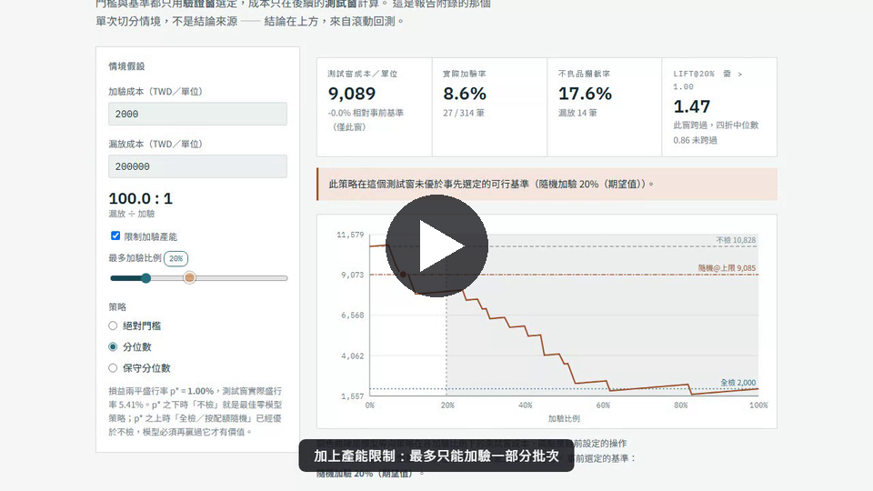
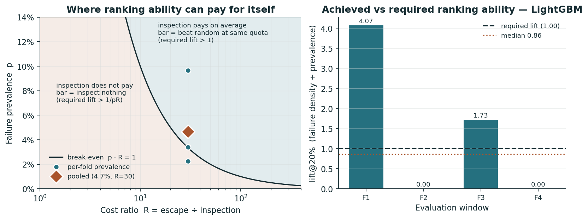
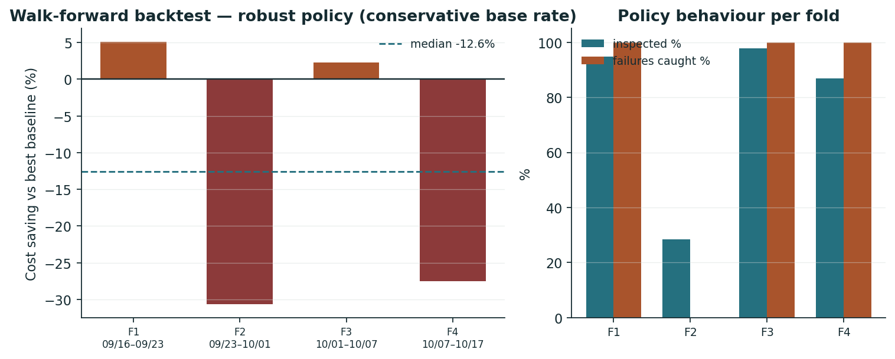
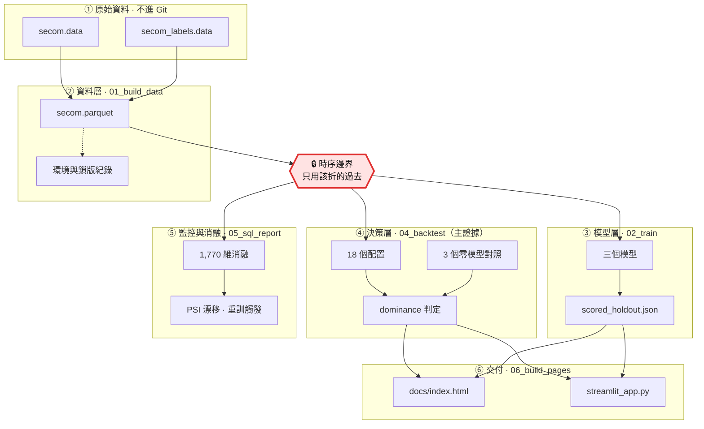

# 從 AUC 到部署決策：半導體品質檢查的成本敏感評估

> 在類別不平衡、檢查產能受限與資料漂移下，模型真的比全檢或隨機抽檢更省成本嗎？

[](https://github.com/mina201199/secom-cost-sensitive-eval/actions/workflows/ci.yml)

**▶ [互動試算頁](docs/index.html)**（`docs/index.html`）— 不需安裝；GitHub 上只會顯示 HTML 原始碼，請下載後用瀏覽器開啟，就能改成本與產能假設看策略怎麼變

[](docs/demo.mp4)

*30 秒 demo：改成本假設、加上產能限制，再看滾動回測 18 個配置沒有一個跨過門檻。*

[English](README.md) · [最新實驗報告](reports/executive_summary.md)

## TL;DR

- **商業結論：在目前的成本假設下，不建議上線這個模型。** 18 個「模型 × 策略 × 產能」配置沒有一個比零模型策略便宜（0 / 18）：產能不限時直接全檢、產能上限 20% 時按配額隨機抽檢，成本都比較低。
- **為什麼可信：** 門檻事先推導（lift 必須 > 1，實測中位數 0.86）、置換檢定 p = 0.52、成本差 bootstrap 區間跨過零。
- **要重新評估需要什麼：** 目前只有 33 個正樣本，最小可偵測 ROC-AUC 是 0.644；要偵測 AUC 0.60 約需 69 筆 fail（2.1 倍），並先確認真實成本與加驗成效。
- 數字來源：[`reports/executive_summary.md`](reports/executive_summary.md)，由腳本從 `reports/metrics/*.json` 產生。

## 要解決的問題

要篩的東西很多、真正有問題的不到 5%（四個評估窗合計 4.7%）、能動用的檢查量有上限、漏掉一個的代價是查一個的 **30 倍**，而且資料分布會隨時間漂移。誰該優先被檢查？

這個形狀不是半導體獨有的 —— 製造業的加驗排程、銀行的洗錢警示分流與盜刷人工覆核、醫療的篩檢分流都是。本專題以公開的 [UCI SECOM](https://archive.ics.uci.edu/dataset/179/secom) 半導體良率資料集為載體。

**多數專案問「模型準不準」，這個專題問「模型值不值得用」**：把有限的檢查名額按模型分數配置，總成本會不會低於完全不用模型。所以對照組是「永遠全檢」和「隨機抽檢」，不是另一個模型。

## 成果與數字

以滾動原點回測比較 18 個配置，對照三個完全不需要模型的固定策略（來源：`reports/metrics/backtest.json`、`reports/executive_summary.md`）：

| 產能情境 | 零模型最佳策略 | 成本／筆 | 最便宜的模型導向配置 | 成本／筆 | 贏過零模型的配置數 |
| --- | --- | ---: | --- | ---: | :---: |
| 無限制 | 永遠全檢 | **2,000** | majority/robust\* | 2,000 | **0 / 9** |
| 最多加驗 20% | 按配額隨機加驗 | **2,644** | lgbm/threshold | 2,677 | **0 / 9** |

\* `majority` 是零資訊 DummyClassifier，保守策略退化成 100% 加驗 —— 那個 2,000 就是全檢掛了模型的名字，追平而非勝過（判定用嚴格小於）。真正用排序的配置都更貴，最便宜的是 `lgbm/robust` 的 2,042。

- **門檻可以事先算出來。** R = 漏放／加驗成本，p = 盛行率。p·R ≥ 1 時（本例 1.40），模型有價值的充要條件化簡成 **lift > 1**。實測四折中位數 **0.86**。
- **置換檢定 p = 0.52。** 模型標記的批次與同配額隨機抽出的批次，成本上無法區分。
- **成本差的 95% bootstrap 區間跨過零**（相對節省 −23.5% ~ +15.9%），只有 43.6% 的重抽樣本模型較便宜。
- **這個設計看不見小訊號。** 33 個正樣本可偵測的最小 ROC-AUC 是 **0.644**，實測約 0.5 —— 證明的是資料量回答不了，而不是模型一定無用。



機制是漂移。以第一折訓練窗為參考，590 欄裡 452 欄算得出 PSI（其餘 138 欄在該窗全缺值 16、零變異 122，PSI 未定義而非 0）。這 452 欄中 PSI > 0.25 的比例在四個窗單調上升 **61% → 64% → 70% → 75%**。



舊版的 +12.4%、8.7:1 與回測百分比已作廢（當時在測試集挑門檻），以實驗報告為準。

## 資料與業務假設

UCI SECOM 有 1,567 筆觀測、104 筆 fail、590 個匿名感測器欄位；4.5% 的儲存格缺值，116 欄零變異。標籤是廠內測試結果，不是客戶端退貨。以下是情境假設：一筆觀測等於一個可獨立加驗單位、加驗必定攔截選中的不良品、加驗 2,000 與漏放 60,000 TWD。真實部署還要確認感測器在決策時已可取得。

**成本假設本身決定了難度。** 2,000 : 60,000 讓 p·R = 1.40 > 1，把情境放進「模型只需贏過隨機抽驗」這個對它最寬鬆的區域。實測仍沒有贏。

## 技術重點：如何避免評估過度樂觀

- 外層依時間切分；每折的前處理、內部 CV 分箱與訓練只用該折可取得的歷史。
- 最終棵數由內部 CV 決定；OOF 校準模型用預先固定的棵數，避免後續標籤反向影響調參。
- 校準窗同時用於校準與策略選擇，不當作獨立成績，只在下一個時間窗評分。
- 每個成本比都在驗證窗重選門檻、在未來窗計價；不做以測試集最佳化門檻的損益兩平宣稱。
- 三個模型、三種策略、兩種產能共用相同時間窗；主結論對照**固定的零模型策略**，它連事前挑錯的機會都沒有。
- 保留沒有 fail 的評估窗：成本照算，無定義指標記為空值。
- SQL 消融對全部原始感測器建歷史特徵，不用測試集 SHAP 排名挑特徵。

主動揭露（詳見報告）：「保守」策略其實是切換成接近全檢的開關（四折選出 86%／28%／98%／95% 加驗），改善來自加驗比例而非排序；Platt 校準是單調變換，不改變分位數策略的決策（`test_calibration_does_not_change_rank_based_decisions`）；`min_estimators: 10` 下限確實在其中一折生效；AUC 刻意不當重訓觸發條件，因為 33 個正樣本下它的抖動大於真實變化。

| 面向 | 比較內容 |
| --- | --- |
| 模型 | Dummy prior、L2 Logistic Regression、LightGBM |
| 策略 | 絕對門檻、分位數、基準率上界調整的保守分位數 |
| 零模型對照 | 永遠不檢、永遠全檢、按整數配額隨機加驗 |
| 不確定性 | 可偵測效果量、成本差 bootstrap 區間、對隨機抽驗的精確置換檢定 |
| 監控 | 盛行率體制判定、特徵 PSI、重訓觸發規則 |
| 消融 | 590 個原始感測器 vs 加入 1,180 個歷史偏離特徵（DuckDB） |

## 這套評估方法如何套用到 AI／LLM 產品

這個 repo 沒有做 LLM 實驗；以下是同一套方法可以直接搬過去的部分：

- **先比零模型基準，而不是比另一個模型。** LLM 功能上線前，先跟「全部轉人工」「規則／關鍵字」「隨機抽查」比總成本，而不是只比 accuracy。
- **用成本加權錯誤，而不是單一指標。** 答錯一題的代價（客訴、錯誤操作）和人工覆核一題的代價通常差很多倍；本專題的 R = 30 就是這個比例，事先算出模型至少要多準才划算。
- **產能限制 = 人工覆核佇列。** 依模型信心分數決定哪些輸出要送人工審，跟「最多加驗 20%」是同一個問題：同配額下，被挑出來的樣本錯誤率要比隨機高（lift > 1）才有價值。
- **門檻在驗證集決定、在未來資料計價。** 拒答門檻、信心門檻不能在 test set 上調；使用者提問分布會漂移，評估要依時間切分並監控輸入分布（本專題用 PSI）。
- **評估集夠不夠大要先算。** 少量 golden set 上兩個 prompt／模型的差距，常常落在 bootstrap 區間或置換檢定的雜訊內；先做檢定力分析，才知道要標註多少樣本。

## 架構

從兩個 UCI 原始檔到一頁能改假設的靜態試算頁，中間六層。紅色那格是防洩漏的核心。



只有 1,567 列、104 個 fail，一點未來資訊漏進訓練就足以讓結論翻面；上一節的規則由 `tests/test_no_leakage.py` 守著。三個零模型對照不經過模型層；`03_decide.py` 只處理單次切分，是附錄而非結論來源，所以沒有畫。

## 如何執行

```bash
pip install -e ".[dev]"
python scripts/01_build_data.py   # 從 UCI 下載原始檔
python scripts/02_train.py
python scripts/03_decide.py       # 單次切分附錄
python scripts/04_backtest.py     # 主結論與不確定性量化
python scripts/05_sql_report.py   # 消融與漂移監控
python scripts/06_build_pages.py  # 產生 docs/index.html
python -m pytest tests/
ruff check .
streamlit run app/streamlit_app.py
```

- **儀表板可以單獨跑，不必先訓練。** 它只讀兩個進版控的小檔（`scored_holdout.json` 與 `backtest.json`），主結論直接讀 `backtest.json` 置頂，不會跟報告矛盾。
- **Windows 請 clone 到短路徑**（例如 `C:\dev\secom`），否則安裝 Streamlit 時可能撞到 260 字元的 `MAX_PATH` 上限。
- 測試：76 個測試，其中 13 個需要 `data/processed/secom.parquet`，而那 13 個正好是全部的洩漏防護測試；CI 會下載 UCI 原始檔，有任何 skip 就失敗（`.github/workflows/ci.yml`）。

**乾淨環境實測**（從 GitHub clone 到全新 venv，照上面指令跑一次）：01 → 06 整條流程含下載 **42 秒**、`ruff check .` 通過、dashboard `healthz` 約 2 秒回 200。那次環境的相依版本與記錄不同（pandas 3.0.6、scikit-learn 1.9.1、matplotlib 3.11.2），`reports/executive_summary.md` 仍與已提交版本**位元組完全相同**；圖檔位元組不同，三個 JSON 有 42 個浮點欄位相對差最多 3.3 × 10⁻¹⁴，整數欄位全部一致。這是觀察而非跨版本穩定的保證。

`requirements.txt` 是相容版本下限；`requirements-lock.txt` 與 `reports/metrics/environment.json` 是驗證環境的實際版本，由 `01_build_data.py` 產生。

## 檔案導覽

- `secom/models.py`：模型、每折前處理、內部時序 CV 與校準。
- `secom/decision.py`：成本、門檻、產能限制，以及 `required_lift` 的推導。
- `secom/backtest.py`：相同未來窗的模型與策略比較，加上 `reference_costs` 的零模型對照。
- `secom/stats.py`：可偵測效果量、成本差 bootstrap、精確置換檢定。
- `secom/drift.py`、`secom/sql.py`：PSI 漂移、重訓觸發、DuckDB 歷史特徵。
- `secom/provenance.py`、`secom/reporting.py`：指標 JSON、環境紀錄，以及把 JSON 渲染成報告。
- `app/streamlit_app.py`、`docs/index.html`：互動試算（Streamlit 與零依賴靜態頁）。
- `tests/`：洩漏防護、門檻選擇、產能、校準排序不變性、SQL 與漂移；另有守文件的測試（`test_stats.py`、`test_documented_counts.py`、`test_architecture_diagram.py`）。

## 已知限制與下一步

- 四折與少量不良品不足以證明穩定泛化；方法修正參考過舊回測，新結果不能當作全新獨立驗證。
- 成本、加驗攔截率與感測器取得時點都是情境假設，需實廠確認。
- 分位數策略假設整個評估窗可一起排序，是批次配置評估、不是逐筆即時部署。
- **負面結果不等於證明所有模型都沒有訊號**；它證明的是這個資料量、粒度與成本假設之下，這個問題無法被回答。
- 下一步：取得新的未見時期資料與真實成本後做前瞻驗證。偵測 AUC 0.60 需要約 69 筆 fail、1,468 筆觀測；AUC 0.55 需要約 275 筆 fail、5,872 筆觀測。

## 我負責的部分

獨立完成：問題定義、評估設計、資料管線、模型與決策策略、統計檢定、儀表板與靜態頁、測試與 CI、文件與 demo 影片。

## 授權

MIT，見 [LICENSE](LICENSE)。UCI SECOM 原始資料不隨 repo 散布，由 `scripts/01_build_data.py` 從來源下載。
